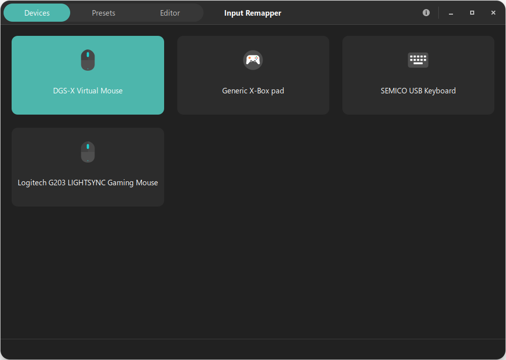
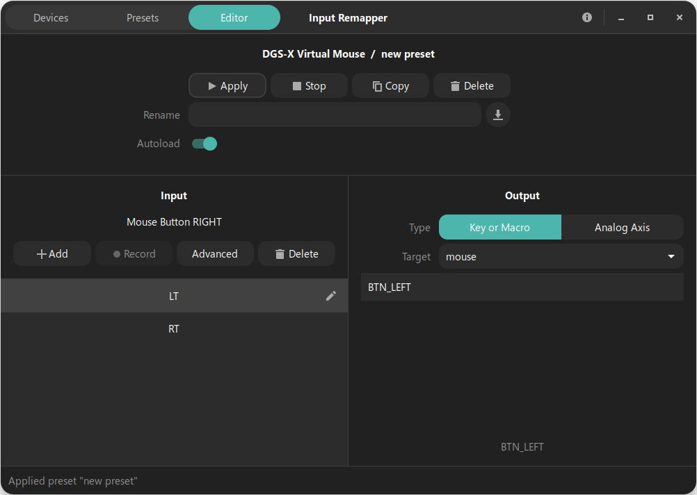
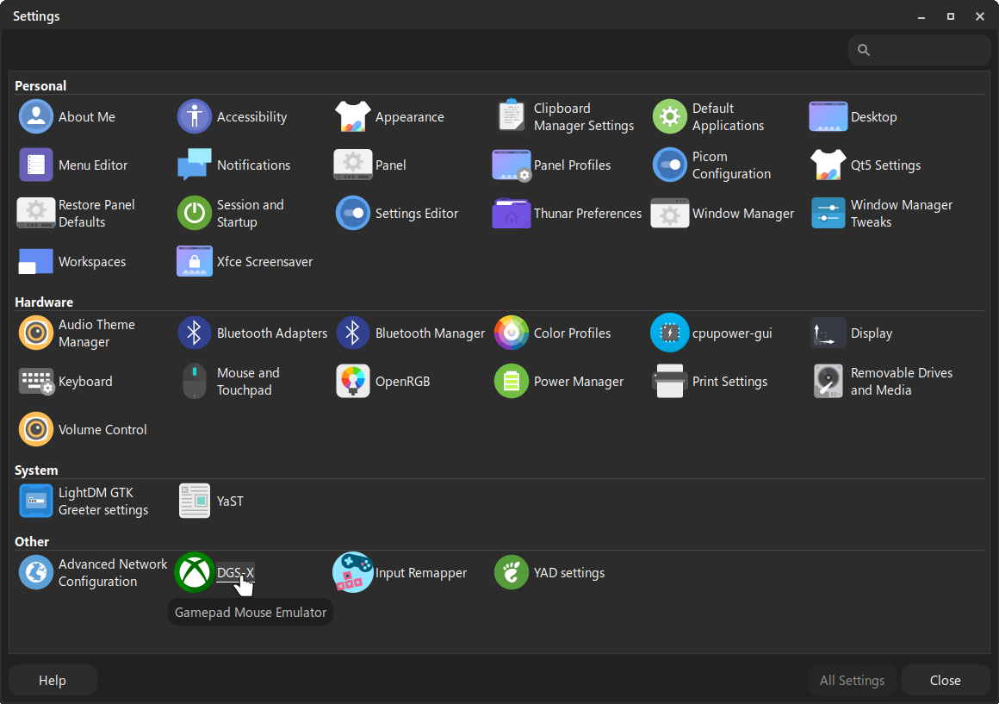
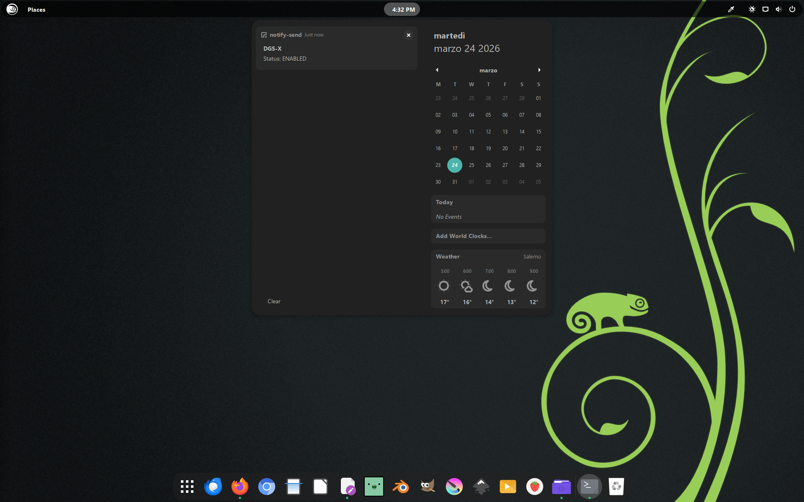
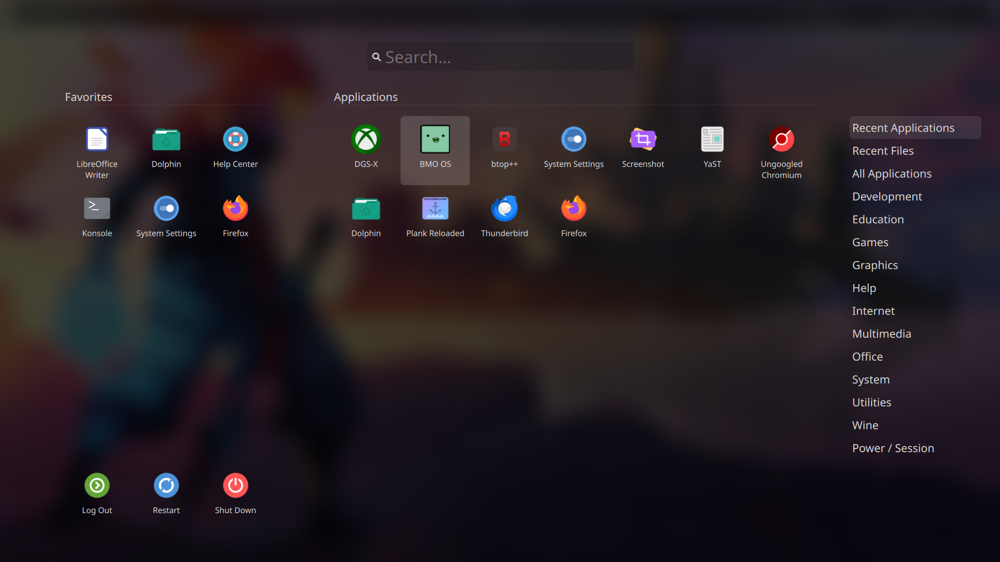
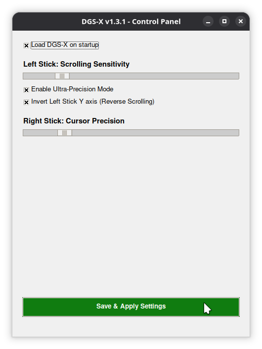

# DGS-X (Desktop Gamepad System - XInput)

DGS-X is a lightweight Linux utility designed to transform your XInput controller (specifically tested by myself on PDP Series S/X and original Xbox One S/X models) into a fully functional desktop navigation tool. It eliminates the need for a mouse by mapping common desktop actions directly to your gamepad. It is the ideal solution for anyone who wants to navigate the web with a comfortable Xbox controller—or compatible ones—straight from a comfy couch, right towards their favorite Linux Multimedia System.

**Version 1.3.1 - Stable Release (what's new)**

1. **Event-Driven Hotplugging**: Migrated from fixed-interval polling loops to `pyudev` for instant detection of gamepads when connected or disconnected.

2. **GNOME Startup Resilience**: Implemented robust exception handling for `pystray` to completely prevent background service crashes during desktop environment initialization.

3. **OpenSUSE Tumbleweed / Kernel Quirk Note**: Licensed wired Xbox controllers (such as the Turtle Beach Rematch) may occasionally experience an `xpad` firmware handshake failure at boot, leaving the controller LED off. If the device is not recognized automatically after a system reboot, quickly reset the kernel module with:
  ```bash
  sudo modprobe -r xpad && sudo modprobe xpad

## 🚀 Installation

DGS-X includes a universal installer that handles dependencies, creates a Python Virtual Environment (venv), and sets up the systemd user service.

1. **Clone the repository:**
   ```bash
git clone https://github.com/Citizen839X/DGS-X-Desktop-Gamepad-System---XInput-.git
   cd DGS-X-Desktop-Gamepad-System---XInput-

2. **Grant execution permissions:**
    ```bash
    chmod +x install.sh

3. **Run the installer:**
    ```bash
    ./install.sh

4. **Reload your session:**
    Log out and log back in (or run newgrp input) to apply the necessary UDEV permissions for your controller.

## 🛠️ Requirements

* Python 3.x with Tkinter support
* evdev, Pillow, pystray (installed automatically via venv)
* XInput Controller (Xbox, PDP, Turtle Beach, or compatible)
* systemd (for the auto-start service)

## 🎮 Default Key Mapping (v1.3.1)

| Controller Input | Desktop Action |
| :--- | :--- |
| **Right Stick** | Mouse Movement (High Precision + Acceleration) |
| **Left Stick (Vertical)** | Mouse Wheel Scroll (Smooth, 25% Speed Reduction) |
| **Right Trigger (RT)** | Mouse Left Click (Selection / Drag & Drop) |
| **Left Trigger (LT)** | Mouse Right Click (Context Menu) |
| **Right Stick Click (R3)** | Mouse Middle Click (M3 / Wheel Click) |
| **Left Bumper (LB)** | Navigation Back (File Manager / Browser) |
| **Right Bumper (RB)** | Navigation Forward (File Manager / Browser) |
| **Dpad** | Directional Navigation (Keyboard arrows) |
| **Start** | Activate/Deactivate DGS-X (press&hold for 3-4 sec.) |

## 💡 Natural Feel Combos:

1. Precision Selection: Hold down the Right Trigger and slowly move the Right Analog Stick to make precise text or file selections.
2. Fast Actions: Double-tap the Right Trigger for standard double-click operations.
3. Window Management: Press and hold the Right Trigger on a window title bar, then move the Right Analog Stick to move the window across your workspace.

## 🛠️ Advanced Customization (Input Remapper Support!)

DGS-X is designed to be modular. Instead of forcing a static mapping, it exports a standard virtual device named **"DGS-X Virtual Mouse"**.

This allows for seamless integration with **Input Remapper**:
* **Native Recognition:** DGS-X appears as a dedicated device in the Input Remapper dashboard.
* **On-the-fly Remapping:** You can invert axes, create macros, or swap buttons (like LT/RT) without touching the DGS-X source code.
* **Profile Management:** Save different mapping presets for different use cases (e.g., Browsing vs. Media Center).

> **Tip:** If you already have Input Remapper installed, DGS-X will respect your active presets "out of the box," maintaining full priority and the hardware Safety Lock as well.
> **Unresponsive Stick?** If your specific controller model uses non-standard Axis IDs (e.g., some legacy or 3rd-party gamepads), simply use Input Remapper to bridge your physical sticks to the DGS-X Virtual Mouse. This ensures 100% compatibility regardless of your hardware's internal mapping.

---

## 🔒 Safety Lock (Lock In / Lock Out)

To prevent accidental inputs during gaming sessions or when away from the desk, DGS-X features a hardware-level safety toggle:

* **Hold START for 3 seconds:** Disables all mouse emulations (**LOCKED**).
* **Hold START for 3 seconds again:** Re-activates the service (**ENABLED**).

*A desktop notification via `notify-send` will confirm the status change (Xfce, GNOME and KDE tested).*

### Tested Hardware & IDs

The following devices have been manually tested and verified for full compatibility:

* **Turtle Beach Xbox Rematch Core Wired Controller**
* **PDP Wired Controller for Xbox Series X/S**
* **Microsoft Xbox Series S/X / One Controller**
* **Generic XInput Compatible Gamepads** (Generic Microsoft/Xbox drivers)

> **Note on PDP Controllers:** While wired, these units offer superior durability feedback and were the main focus development target for DGS-X. However, you can use the original gamepad as well and the right stick sensitiveness basics may logically differ.

## Screenshots & Integration

DGS-X integrates seamlessly across different Linux desktop environments, appearing as a native system service.

### 🎮 Device Detection & Mapping

| Virtual Device Detection | Preset Editor & Mapping |
| :---: | :---: |
|  |  |
| *DGS-X Virtual Mouse detected* | *Mapping logic for LT/RT and triggers* |

### 🖥️ Desktop Environment Integration

| XFCE Settings | GNOME Notifications | KDE Plasma Dash | Application Menu |
| :---: | :---: | :---: | :---: |
|  |  |  |  |
| *XFCE System Category* | *Status Notifications* | *Application Dashboard* | *System Menu Integration* |

---
**Author:** Carlo Sitaro

**License:** GNU GPLv3
